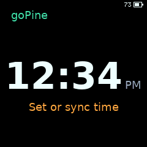
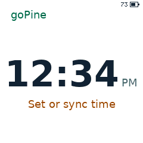
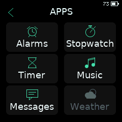
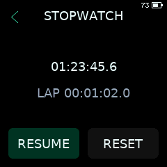

# goPine

goPine is PineTime smartwatch firmware written in Go with
[TinyGo](https://tinygo.org/). This is a developer project: build it locally and
use an SWD debugger for the first install, then update over Bluetooth.

[Browser updater](https://distortions81.github.io/goPineTime/) ·
[Firmware and releases](https://github.com/Distortions81/goPineTime/releases)

<p>
  
  
  
  
</p>

*Screenshots from the desktop simulator.*

## Features

- 12/24-hour clock, five alarms with snooze, stopwatch with laps, and countdown timer.
- Battery and charging display; light/dark themes, brightness, rotation, and tap to wake.
- Persistent settings, alarms, and timer state.
- Optional Bluetooth time sync, notifications, and music controls; two saved devices.
- In-app Bluetooth firmware updates with on-watch confirmation and rollback.

Phone features depend on the companion app and permissions. InfiniLink music
controls target Apple Music; notification dismissal is local to the watch.
Weather is disabled in the UI. Motion and heart-rate tracking are not implemented.
Battery percentage is a voltage estimate, and runtime is still being evaluated.

## Build and first install

Requires Go 1.27.1, TinyGo 0.42.0, Python 3, clang, and LLVM tools (`llvm-ar`,
`llvm-nm`, `llvm-dwarfdump`, `llvm-objdump`). For flashing, use a 3.3 V SWD probe
with access to the PineTime debug pads and a programmer such as pyOCD.

From the repository root, fetch the pinned BLE dependency and build:

```sh
git clone https://github.com/InfiniTimeOrg/InfiniTime.git build/deps/InfiniTime
git -C build/deps/InfiniTime checkout --detach 6c119eb52206b580b556b41633dddc1e1b66a8da
version=0.3.38  # Set to the version you are building.
bash scripts/build-ota.sh --bootstrap "$version"
bash scripts/build-ota.sh --ble "$version"
go run ./cmd/otapack \
  -elf "build/ota/gopine-$version.elf" -version "$version" \
  -bootloader build/assets/bootloader-1.0.1.bin -out build/bootstrap
```

The bootstrap build downloads and verifies the stock bootloader/recovery assets
and initializes TinyGo's libc headers. The final command packages the BLE build
into a combined bootloader/application HEX.

Connect SWDIO, SWCLK, and ground. Power the battery-connected watch from its
charger; do not connect a second supply to VCC. Back up existing firmware if
needed. Flash the recovery helper first:

```sh
pyocd flash -t nrf52832 -f 1000000 -O auto_unlock=false -e sector \
  "build/bootstrap/gopine-recovery-setup-$version.hex"
pyocd reset -t nrf52832 -f 1000000 -O auto_unlock=false
```

**Wait for Recovery ready on the watch**, then flash the combined image:

```sh
pyocd flash -t nrf52832 -f 1000000 -O auto_unlock=false -e sector \
  "build/bootstrap/gopine-bootstrap-$version.hex"
pyocd reset -t nrf52832 -f 1000000 -O auto_unlock=false
```

Use sector erase, not mass erase or automatic unlock. The helper replaces the
running firmware and provisions recovery; complete both steps. The final image
contains MCUboot and a confirmed goPine build. Set or sync the clock afterward.

For standalone SWD development, `targets/pinetime-gopine.json` builds without
MCUboot. It starts at address zero and overwrites an installed bootloader;
use the bootstrap procedure above for Bluetooth updates and rollback.

## Bluetooth updates

Requires a BLE build of goPine 0.3.22 or newer already installed.
Build with `bash scripts/build-ota.sh --ble "$version"`, or download a release ZIP.

1. Open the [browser updater](https://distortions81.github.io/goPineTime/) in a
   Web Bluetooth browser and choose the firmware ZIP.
2. On the watch, open **Settings → Firmware Update** and hold until
   **Ready to connect**. Use at least 20% battery or external power.
3. Connect to **goPine Update** and keep the page open through verification.
4. Tap **INSTALL**, then **KEEP** after reboot.

On Linux Chrome, Bluetooth may require enabling
`chrome://flags/#enable-experimental-web-platform-features`. For the Linux/BlueZ
uploader and local web controls:

```sh
bash scripts/ota-update.sh "$version" \
  --package "build/ota/gopine-update-$version.zip" \
  --adapter hci0 --address YOUR_WATCH_ADDRESS --web
```

Select your own adapter and goPine address. A disconnected transfer can resume
in the same sender session; closing the page or restarting the watch requires
a new session. Native ZIPs are not compatible with InfiniTime's DFU updater.
Images are unsigned; checksums detect corruption, not publisher authenticity.

## Recovery

A reset before **KEEP** requests trial rollback. To reach the stock MCUboot menu,
hold the side button until restart: release at green for normal boot, blue for
the image remaining in the secondary slot, or red for InfiniTime recovery.
Rollback cannot restore an overwritten image. Recovery uses compatible external
DFU tools and official InfiniTime packages; reinstall goPine over SWD if needed.

## Development

Install SDL2 development libraries (`libsdl2-dev` on Debian/Ubuntu), then run:

```sh
go run .
go test ./...
go vet ./...
```

Mouse clicks/drags simulate touch; Space is the side button. Set
`GOPINE_SIM_STORAGE=/path/to/watch.flash` for persistent simulator settings.
Swipe right from the clock for Apps and left for Settings. Bluetooth and tap to
wake default to off; enable them in Settings. The clock needs manual setting or
phone sync after an unexpected reset.

Tagging `vMAJOR.MINOR.PATCH` runs the tested BLE release workflow. It publishes
update ZIPs and resource reports; wired bootstrap images are built locally.
The [BLE port README](internal/ble_nimble/README.md) covers architecture and tests.
